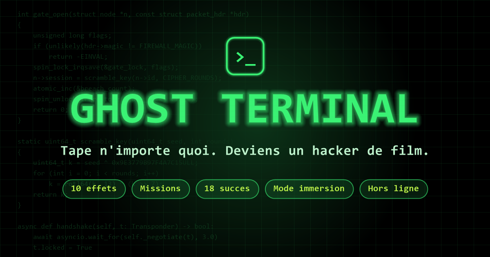

# Ghost Terminal



**Tape n'importe quoi sur ton clavier… et deviens un hacker de film.**

Chaque touche fait apparaître du vrai code (coloré comme dans un éditeur), et des dizaines d'effets dramatiques transforment ton écran en scène de film d'espionnage.

👉 **[Essayer Ghost Terminal en ligne](https://natxmans.github.io/ghost-terminal/)**

---

## ✨ Fonctionnalités

- **7 langages** de faux code : C, Python, JavaScript, Rust, Go, Assembleur x86 et Bash. Le code raconte le plan (complètement fictif et ridicule) d'un super-méchant qui déclenche la fin du monde : journal de bord, sbires, étapes détaillées… Méchant, base secrète, code de lancement, arme et étapes sont **tirés au hasard** : à chaque fois que tout le code a été tapé (5 000 à 9 000 caractères), un nouveau plan est inventé.
- **Ton propre code** : colle-le dans les réglages pour qu'il s'écrive à l'écran. Les gros mots sont bloqués et remplacés par des jurons de BD (`#@!%`).
- **Mode histoire « PROTOCOLE ÉCHO »** : continue de taper… au bout d'un moment, quelque chose se réveille dans le terminal. **3 actes et 11 chapitres** en cinématiques. Chaque chapitre a ses **objectifs** (taper du code, lancer certains effets, terminer une mission, désamorcer une ogive…), affichés en haut à gauche.
  - **12 fragments de mémoire** passent pendant que tu tapes : attrape-les avec `Tab` (ou en les touchant) pour découvrir qui est vraiment ÉCHO.
  - **7 mini-jeux** : séquence à mémoriser, course-poursuite, code à taper, fil à couper, déchiffrement, fréquence à caler et labyrinthe.
  - **Des choix qui comptent** (prévenir Kane ou non, faire confiance à ÉCHO ou non, détruire le satellite ou le lui confier…) et **3 fins**, dont une vraie fin réservée à ceux qui ont retrouvé toute la mémoire d'ÉCHO.
  - Un épilogue secret pour ceux qui débloquent 100 % des succès, et un **jeu secret** pour les plus acharnés. Surtout, ne touchez pas au gros bouton rouge.
- **Un endroit secret** 🐧 : lis bien les plans que tu tapes. Pour une fois, ce que tu tapes vraiment pourrait ouvrir une porte…
- **Un seul univers** : le faux code, les effets et les missions racontent tous la même histoire. Une IA nommée ÉCHO, les super-méchants du Consortium et l'agent Kane de la Division Zéro.
- **10 effets dramatiques** à lancer avec `Maj` + `1` … `0`, cumulables, dans des fenêtres déplaçables.
- **Mode mission** : une opération complète qui enchaîne plusieurs effets toute seule.
- **Pilote automatique** : le code s'écrit sans toucher au clavier.
- **Mode immersion** : plus aucune interface, juste le terminal. Parfait pour une blague.
- **38 succès** à débloquer (plus quelques secrets), et un code secret caché 🌈.
- **Voix de l'ordinateur** (synthèse vocale) et **sons** générés en direct.
- **HUD « Ton système » en direct** : la vraie charge de la page, la mémoire, ta batterie, les images par seconde, ton système, ton navigateur, tes cœurs de processeur, ta RAM, ton écran et ton réseau. Tout est lu dans ton navigateur et rien n'est envoyé nulle part.
- **Sauvegarde** (réglages › sauvegarde) : exporte ta progression dans un fichier et réimporte-la sur un autre appareil ou une autre version du jeu (site, itch.io). Le fichier importé est vérifié avant d'être utilisé.
- **Tout réinitialiser** (réglages › zone dangereuse) : efface succès, histoire et réglages pour repartir de zéro.
- **Confort** : mode calme (moins de flashs et de tremblements, activé d'office si ton appareil demande moins d'animations) et vitesse des dialogues réglable.
- **Statistiques** (panneau Succès) : temps de jeu, record de vitesse, effets lancés, missions réussies, chapitres, fragments et fins découvertes.
- **Résumé de l'histoire** : un rappel « Précédemment… » quand tu reviens en pleine histoire, et le récapitulatif de tes choix dans le panneau Succès.
- **7 thèmes** de couleur (et 2 thèmes secrets à débloquer) et effet écran CRT.
- **Application installable** qui marche **hors ligne** (PWA).
- **Téléphone et tablette** : touche l'écran pour écrire du code (le bouton ⌨ ouvre le vrai clavier si tu veux), 3 doigts = accès autorisé, 4 doigts = accès refusé. Les consignes, les objectifs et les mini-jeux s'adaptent à l'écran tactile, la page s'ajuste aux encoches et au mode paysage, et le téléphone vibre aux moments forts (désactivable). Même le code de triche secret se dessine au doigt.

## ⌨️ Raccourcis

| Touche | Action |
|---|---|
| N'importe quelle touche | Écrire du code |
| `Alt` ×3 | ACCÈS AUTORISÉ |
| `Verr. Maj` ×3 | ACCÈS REFUSÉ |
| `Maj` + `1` | Brèche système |
| `Maj` + `2` | Caméra & micro (simulés) |
| `Maj` + `3` | Traçage GPS |
| `Maj` + `4` | Explorateur de fichiers |
| `Maj` + `5` | Requête base de données |
| `Maj` + `6` | Cassage de mot de passe |
| `Maj` + `7` | Balayage satellite |
| `Maj` + `8` | Ogive du Consortium (à désamorcer !) |
| `Maj` + `9` | Réseau mondial |
| `Maj` + `0` | Mode fantôme |
| `F1` | Aide |
| `F2` | Téléchargement |
| `F3` | Mode mission |
| `F6` | Pilote automatique |
| `F7` | Panneau HUD |
| `F8` | Thème suivant |
| `F9` | Réglages |
| `F10` | Mode immersion |
| `Tab` | Attraper un fragment de mémoire (mode histoire) |
| `Échap` | Tout fermer |

## 🔒 Tout est faux (et sans danger)

Ghost Terminal est un **jouet**. Rien n'est piraté : la caméra, le micro, le GPS et les fichiers affichés sont **100 % simulés**, et le « plan de fin du monde » n'est qu'une parodie de film qui ne fait strictement rien. Le site n'accède à aucun de tes appareils et ne collecte aucune donnée : les réglages et succès restent dans ton navigateur, et seules les polices d'écriture sont chargées depuis Google Fonts.

## 🚀 Lancer en local

Aucune installation : ouvre simplement `index.html` dans ton navigateur.

Pour profiter de l'installation en application et du mode hors ligne, sers le dossier avec un petit serveur, par exemple :

```bash
python -m http.server 8000
```

puis ouvre <http://localhost:8000>.

## 📁 Structure

| Fichier | Rôle |
|---|---|
| `index.html` | La page |
| `style.css` | Le design (thèmes, fenêtres, effets) |
| `app.js` | Le moteur : frappe, fenêtres, missions, succès, HUD, son, voix |
| `effects.js` | Les 11 effets dramatiques |
| `story.js` | Le mode histoire et ses cinématiques |
| `survie.js` | Le jeu secret 🤫 |
| `filtre.js` | Le filtre anti-gros mots de « Mon code » |
| `mots.js` | Le grand sac de mots du faux code, classés par thèmes |
| `snippets.js` | Le générateur de faux code : il assemble les mots qui vont le mieux ensemble (un nouveau plan à chaque tour) |
| `highlight.js` | La coloration du code |
| `icons.js` | Les icônes |
| `security.js` | La protection anti-copie |
| `sw.js`, `manifest.webmanifest` | L'application installable et le mode hors ligne |
